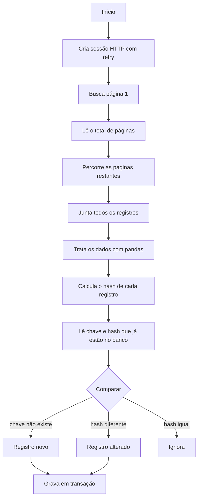

# 🔄 Extração de Dados via API para PostgreSQL (ETL Incremental)

Exemplo de pipeline de dados que extrai registros de uma **API REST** de um sistema ERP, trata os dados com **Python e pandas** e carrega o resultado em um banco **PostgreSQL**, gravando apenas o que é novo ou foi alterado.

> ⚠️ **Sobre este repositório:** é uma versão **anonimizada** de um script que usei em ambiente profissional. O nome do sistema, os endpoints, as credenciais, os nomes de banco e os dados foram substituídos por exemplos genéricos. A lógica (paginação, tratamento e carga incremental) é a mesma da versão real.

## 🎯 O problema

Sistemas ERP guardam os dados em seus próprios bancos e oferecem acesso por API, normalmente com **limite de registros por chamada**. Para analisar esses dados (BI, relatórios, conciliações), é preciso copiá-los para um banco próprio de forma **automática, confiável e sem duplicar informação**.

## 🧭 Visão geral do fluxo



## 🧩 Como funciona, passo a passo

### 1. Sessão HTTP com retry
Em vez de chamar `requests.post` solto, o script cria uma `requests.Session` com:
- **Cabeçalhos fixos** (autenticação, tipo de conteúdo), definidos uma vez só;
- **Retry automático** para erros temporários do servidor (`429`, `500`, `502`, `503`, `504`), com **backoff**: a espera cresce a cada tentativa, o que evita sobrecarregar uma API que já está instável.

### 2. Paginação
A API não devolve tudo de uma vez. Ela entrega, por exemplo, 50 registros por chamada. A estratégia é:

1. Chamar a **página 1**. A resposta traz os registros e também o **total de páginas**.
2. Com esse número, rodar um laço `for pagina in range(2, total_paginas + 1)`.
3. Juntar os registros de cada página em uma única lista.

Exemplo: 230 registros com 50 por página = 5 páginas (a última com 30).

Cuidados que o código toma:
- **Pausa entre as páginas** (`time.sleep`) para respeitar o limite de requisições da API.
- **Retry por página**: se uma chamada falha por timeout ou queda de conexão, tenta de novo (3s, 6s, 9s...) antes de desistir.
- **Falha isolada**: se uma página não carrega mesmo após as tentativas, ela é registrada em uma lista e o restante da extração continua. O script avisa quais páginas falharam, e elas são recuperadas na execução seguinte.

### 3. Tratamento dos dados (pandas)
- **`json_normalize`**: a API devolve JSON aninhado, como `{"endereco": {"cidade": "BH"}}`. O pandas achata isso em colunas planas (`endereco_cidade`).
- **Padronização de nomes**: pontos viram `_` e tudo vai para minúsculas, o que facilita as consultas SQL.
- **Datas**: colunas cujo nome indica data são convertidas de `dd/mm/aaaa` para data de verdade. Valores inválidos viram `NaT` (nulo) em vez de quebrar o script (`errors="coerce"`).
- **Chave única**: o campo identificador é convertido para texto e as **duplicatas são removidas** (mantendo a última ocorrência).

### 4. Hash para detectar mudanças
Cada registro recebe um **hash MD5** calculado sobre todo o seu conteúdo. Se qualquer campo mudar, o hash muda.

Para que o hash seja sempre igual quando os dados são iguais, o conteúdo é **normalizado** antes: chaves de dicionários ordenadas, `NaN`, `NaT` e `None` tratados como o mesmo valor, tipos do numpy convertidos para tipos nativos, datas em formato ISO.

> O MD5 aqui serve só para **comparar versões** de um registro. Não tem função de segurança.

### 5. Carga incremental
Em vez de apagar e recarregar a tabela inteira a cada execução, o script:

1. Lê do banco **somente a chave e o hash** (consulta leve).
2. Compara com os dados recém-extraídos:
   - **Chave que não existe no banco** → registro **novo**
   - **Chave existe, hash diferente** → registro **alterado**
   - **Chave existe, hash igual** → nada a fazer
3. Grava apenas novos e alterados.

Os alterados são **apagados e reinseridos** já atualizados. Tudo acontece dentro de uma **transação** (`engine.begin()`): se algo falhar no meio, nada é gravado, e o banco nunca fica com a tabela pela metade.

**Vantagens:** execução mais rápida, menos carga no banco e uma tabela sempre consistente. Pode rodar todo dia sem duplicar nada.

## 🔐 Boas práticas aplicadas

- Credenciais e endereços **só em variáveis de ambiente** (veja `.env.example`). Não existe valor padrão no código: se faltar variável, o script para.
- `.env` está no `.gitignore`.
- Consultas com parâmetros (`bindparam`), sem montar valores dentro do texto do SQL.

## 🛠️ Tecnologias

Python · pandas · requests · SQLAlchemy · PostgreSQL

## ▶️ Como executar

```bash
pip install -r requirements.txt
cp .env.example .env      # preencha com seus dados
export $(grep -v '^#' .env | xargs)
python extrator_exemplo.py
```

Para adaptar a outra API, ajuste:

| O que | Onde |
|---|---|
| Endereço e autenticação | `API_URL`, `API_TOKEN` e `criar_sessao()` |
| Formato do corpo da requisição e das chaves de resposta (`dados`, `total_paginas`) | `buscar_pagina()` e `extrair_todas_paginas()` |
| Campo identificador | `CAMPO_CHAVE` |
| Colunas de data | `PADROES_DATA` |
| Schema e tabela de destino | `SCHEMA_DESTINO` e `TABELA_DESTINO` |

## 📌 Possíveis melhorias

- Agendar a execução (cron, Task Scheduler ou GitHub Actions)
- Registrar logs em arquivo em vez de `print`
- Carga em lote (`method="multi"`) para tabelas muito grandes
- Tratar registros excluídos na origem
- Testes automatizados para as funções de tratamento e comparação

## 👤 Autor

**Gabriel** | Analista de Dados
